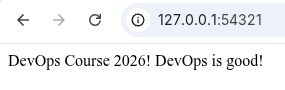
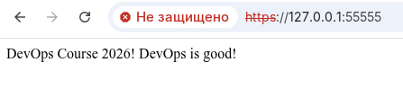

Я студентка ПГНИУ, ИКНТ, 3 курс, группа ИТ-13-2024, Палкина Софья. Здесь я разместила файлы и результаты работы лабораторной работы №7 по предмету "Devops и администрирование (Методы и инструменты DevOps)".

Были выполнены основные и доп. задачи.
Порт https: 55555

Вывод deploy.sh:
```bash
sonya@sonyaserver:~/lab7$ ./deploy.sh
+ docker stop nginx-cont
nginx-cont
+ docker rm nginx-cont
nginx-cont
+ docker build -t devops/nginx-server ./nginx
[+] Building 0.8s (11/11) FINISHED                                                     docker:default
 => [internal] load build definition from dockerfile                                             0.0s
 => => transferring dockerfile: 384B                                                             0.0s
 => [internal] load metadata for docker.io/library/nginx:latest                                  0.0s
 => [internal] load .dockerignore                                                                0.0s
 => => transferring context: 2B                                                                  0.0s
 => [1/6] FROM docker.io/library/nginx:latest@sha256:fb01117203ff38c2f9af91db1a7409459182a37c87  0.0s
 => => resolve docker.io/library/nginx:latest@sha256:fb01117203ff38c2f9af91db1a7409459182a37c87  0.0s
 => [internal] load build context                                                                0.0s
 => => transferring context: 3.23kB                                                              0.0s
 => CACHED [2/6] ADD ./index.html /var/www/html/index.html                                       0.0s
 => CACHED [3/6] ADD ./nginx-conf/nginx.conf /etc/nginx/conf.d/default.conf                      0.0s
 => [4/6] ADD ./certificates/certificate.crt /etc/nginx/ssl/                                     0.0s
 => [5/6] ADD ./certificates/key.key /etc/nginx/ssl/                                             0.0s
 => [6/6] RUN /usr/sbin/nginx -t                                                                 0.2s
 => exporting to image                                                                           0.2s
 => => exporting layers                                                                          0.1s
 => => exporting manifest sha256:461fd1bcbf58f3a7779edecf3ea94529e8976bd0378786b16ed15d755a281b  0.0s
 => => exporting config sha256:9eb97d7a072795b413fa6ab4b766b0918f20e9970b09a3de620471ac68a21f8b  0.0s
 => => exporting attestation manifest sha256:3b66715a1339886b649c772ec38bebaaeebb08b57469b14921  0.0s
 => => exporting manifest list sha256:156fef6b231b371a96afeb8d696ec2eb005f334f17495b4a85376b384  0.0s
 => => naming to docker.io/devops/nginx-server:latest                                            0.0s
 => => unpacking to docker.io/devops/nginx-server:latest                                         0.1s
+ docker run -d --name nginx-cont -p 54321:80 -v ./nginx/certificates:/etc/nginx/ssl:ro -p 55555:443 --restart unless-stopped devops/nginx-server
2c82ca2597acec5c2c16369fd4c87aac26385eafa451d21a52146de4d6418fb7
+ docker ps -a
CONTAINER ID   IMAGE                 COMMAND                  CREATED                  STATUS                  PORTS                                                                                    NAMES
2c82ca2597ac   devops/nginx-server   "/docker-entrypoint.…"   Less than a second ago   Up Less than a second   0.0.0.0:54321->80/tcp, [::]:54321->80/tcp, 0.0.0.0:55555->443/tcp, [::]:55555->443/tcp   nginx-cont
2e1f79879542   a7a6cce5ab1d          "/docker-entrypoint.…"   9 hours ago              Up 9 hours              0.0.0.0:54322->80/tcp, [::]:54322->80/tcp, 0.0.0.0:55443->443/tcp, [::]:55443->443/tcp   nginx-container
25edf259843f   zapret-docker         "./service.sh run --…"   7 weeks ago              Up 12 hours                                                                                                      zapret
b4f75644bd5b   zapret-docker         "-d"                     7 weeks ago              Created                                                                                                          amazing_kilby
+ sleep 5
+ curl 127.0.0.1:54321
<!DOCTYPE html>
<html>
    <head>
        <title> DevOps Course 2026</title>
    </head>
    <body>
        DevOps Course 2026! DevOps is good!
    </body>
</html>
+ docker logs -n 10 nginx-cont
2026/11/20 04:32:48 [notice] 1#1: start worker processes
2026/11/20 04:32:48 [notice] 1#1: start worker process 28
2026/11/20 04:32:48 [notice] 1#1: start worker process 29
2026/11/20 04:32:48 [notice] 1#1: start worker process 30
2026/11/20 04:32:48 [notice] 1#1: start worker process 31
2026/11/20 04:32:48 [notice] 1#1: start worker process 32
2026/11/20 04:32:48 [notice] 1#1: start worker process 33
2026/11/20 04:32:48 [notice] 1#1: start worker process 34
2026/11/20 04:32:48 [notice] 1#1: start worker process 35
172.17.0.1 - - [20/Nov/2026:04:32:53 +0000] "GET / HTTP/1.1" 200 164 "-" "curl/8.22.0" "-"
+ curl 127.0.0.1:55555
<html>
<head><title>400 The plain HTTP request was sent to HTTPS port</title></head>
<body>
<center><h1>400 Bad Request</h1></center>
<center>The plain HTTP request was sent to HTTPS port</center>
<hr><center>nginx/1.29.4</center>
</body>
</html>
+ curl -k https://127.0.0.1:55555
<!DOCTYPE html>
<html>
    <head>
        <title> DevOps Course 2026</title>
    </head>
    <body>
        DevOps Course 2026! DevOps is good!
    </body>
</html>
```

Вывод скрипта обновления сертификатов:
```bash
sonya@sonyaserver:~/lab7$ ./update.sh
...+...+...+..+......+.+.........+..+...+.+........+...+...+....+...+...+..+.........+....+...............+.....+.........+.+++++++++++++++++++++++++++++++++++++++*..+...+....+...+..+.+...+..+.......+........+.......+++++++++++++++++++++++++++++++++++++++*.+...+.....+..........++++++
.........+...+.....+.+.....+....+...+...+.....+.+...........+.......+.....+......+.+......+.....+.........+....+++++++++++++++++++++++++++++++++++++++*.+....................+...+.......+...+++++++++++++++++++++++++++++++++++++++*.........+...+.........++++++
-----
2026/11/20 04:33:53 [notice] 36#36: signal process started
```

Проверка через браузер:  
http://127.0.0.1:54321  


https://127.0.0.1:55555  
